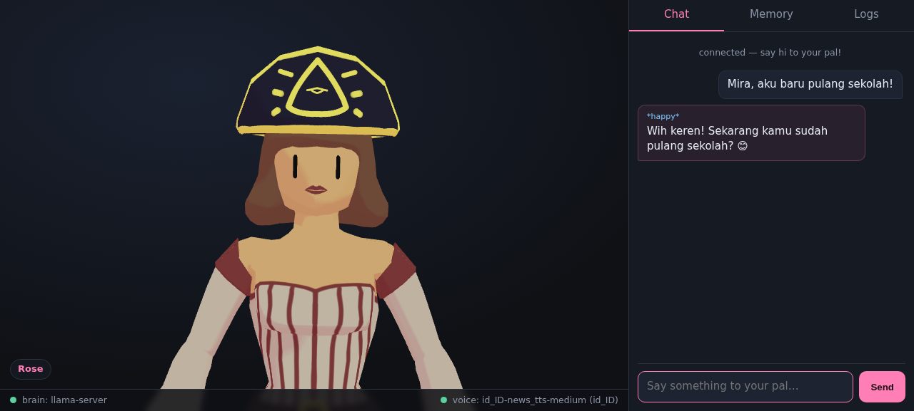

# vtpal

[](https://github.com/lunarjjo/vtpal/actions/workflows/ci.yml)
[](LICENSE)
[](package.json)

**vtpal** adalah teman AI VTuber yang berjalan sepenuhnya lokal: avatar 3D di
browser, mengobrol memakai model bahasa kecil di komputermu sendiri,
mengucapkan setiap balasan dengan lip-sync, mengingat apa yang kamu ceritakan,
dan menyimpan log sesi. Tanpa cloud, tanpa API key, tanpa telemetri.



## Cara kerja

- **Otak** — Qwen3-0.6B (Apache-2.0) dilayani `llama-server` resmi, mode
  thinking dimatikan keras lewat `chat_template_kwargs`.
- **Suara** — piper (MIT) dengan voice Indonesia `id_ID-news_tts-medium`; PCM
  mentah dibungkus WAV di server memakai sample rate voice.
- **Wajah** — `Rose.vrm` (CC0 karya Polygonal Mind) dirender three.js +
  three-vrm (keduanya di-vendor, MIT). Tag suasana seperti `[happy]` diparsing
  dari teks dan menggerakkan ekspresi avatar.
- **Lip-sync** — browser menganalisis audio TTS (WebAudio RMS) dan menggerakkan
  bobot ekspresi `aa`/`ih` setiap frame.
- **Memori** — profil JSON: fakta yang kamu ajarkan (`ingat: ...`),
  di-deduplikasi dengan kemiripan Jaccard, di-recall lewat kata kunci.
- **Log** — setiap giliran obrolan ditambahkan ke berkas JSONL harian di
  `data/logs/`, bisa dibaca di tab Logs.

## Mulai cepat

Syarat: Node.js ≥ 18, ~1 GB disk. Linux x86_64 (jalur teruji) / macOS;
pengguna Windows: `scripts\setup.bat`.

```sh
sh scripts/setup.sh     # unduh llama-server, piper, otak 639 MB, voice ID
npm start               # hidupkan otak + aplikasi web
# buka http://127.0.0.1:3000
```

Hal yang bisa dicoba:

- `Halo Mira! Kamu lagi apa?` — ngobrol dalam Bahasa Indonesia atau Inggris.
- `ingat: warna favoritku hijau` lalu tanya `warna favoritku apa?`.
- Tab **Memory** untuk mengajarkan/menghapus fakta; tab **Logs** untuk jurnal.

## Konfigurasi (variabel lingkungan)

| Variabel | Default | Arti |
| --- | --- | --- |
| `APP_PORT` | `3000` | Port web UI + API |
| `VTPAL_PERSONA` | `Mira` | Nama teman di prompt |
| `VTPAL_MODEL` | `runtime/model/Qwen3-0.6B-Q8_0.gguf` | Model GGUF apa pun |
| `VTPAL_VOICE` / `VTPAL_VOICE_CONFIG` | `runtime/voice/id_ID-...` | Pasangan voice piper apa pun (30+ bahasa) |
| `VTPAL_STUB` | `0` | `1` = jalan tanpa biner (untuk test/CI) |

## Keterbatasan (jujur)

- Qwen3-0.6B sangat kecil: jawabannya menarik tapi kadang keliru, dan pemahaman
  perspektif atas fakta yang diingat lemah.
- Belum ada speech-to-text — kamu mengetik, dia berbicara.
- Suara bawaan adalah pembaca berita kualitas "medium"; ganti voice untuk
  karakter yang lebih hidup.

## Lisensi

MIT untuk kode repo ini. Komponen pihak ketiga memakai lisensinya masing-masing
— rincian di [LICENSES-NOTICE.md](LICENSES-NOTICE.md).
