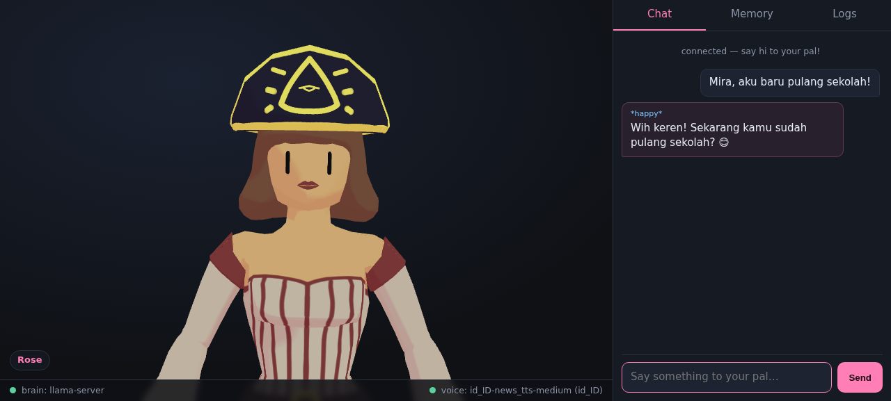

# vtpal

[](https://github.com/lunarjjo/vtpal/actions/workflows/ci.yml)
[](LICENSE)
[](package.json)
[](package.json)

**vtpal** is a local-first AI VTuber companion: a 3D avatar that lives in your
browser, chats with you through a tiny language model running on your own
machine, speaks every reply out loud with lip-sync, remembers what you tell
her, and keeps a session log. No cloud, no API keys, no telemetry.



## How it works

```
 browser                     node server (zero deps)              sidecars
┌─────────────────┐   HTTP   ┌────────────────────────┐  spawn  ┌──────────────┐
│ three.js +      │ ───────► │  /api/chat  ───────────┼────────►│ llama-server │
│ three-vrm       │          │  memory recall + logs  │         │ Qwen3-0.6B   │
│ (Rose.vrm CC0)  │ ◄─────── │  /api/tts   ───────────┼────────►│ piper TTS    │
│ lip-sync via    │  audio/  │  sanitize + wrap WAV   │         │ id_ID voice  │
│ WebAudio RMS    │   wav    │  /api/memory /api/logs │         │ (22.05 kHz)  │
└─────────────────┘          └────────────────────────┘         └──────────────┘
```

- **Brain** — [Qwen3-0.6B](https://huggingface.co/Qwen/Qwen3-0.6B-GGUF)
  (Apache-2.0) served by the official `llama-server` binary, thinking mode
  hard-disabled via `chat_template_kwargs` (the soft `/no_think` prompt switch
  alone lets the model burn the entire completion in `reasoning_content`).
- **Voice** — [piper](https://github.com/rhasspy/piper) (MIT) with the
  Indonesian `id_ID-news_tts-medium` voice; raw PCM is wrapped into a WAV
  server-side using the voice's declared sample rate.
- **Face** — `Rose.vrm` (CC0 by Polygonal Mind, found via the
  [Open Source Avatars](https://github.com/ToxSam/open-source-avatars) CC0
  registry) rendered with three.js + @pixiv/three-vrm, both vendored (MIT).
  Mood tags like `[happy]` that the model emits are parsed out of the text,
  shown in chat, and drive avatar expression presets.
- **Lip-sync** — the browser analyses the TTS audio (WebAudio RMS) and drives
  the `aa`/`ih` expression weights every frame.
- **Memory** — plain JSON profile per companion: facts you teach her
  (`remember this: ...` / `ingat: ...`), deduplicated with Jaccard similarity,
  recalled by keyword overlap and injected into the system prompt.
- **Logs** — every conversation turn is appended to a daily JSONL file under
  `data/logs/`, viewable in the Logs tab.

## Quick start

Requires: Node.js ≥ 18, ~1 GB disk, any Linux x86_64 (tested) or macOS
Windows users: `scripts\setup.bat`.

```sh
sh scripts/setup.sh     # fetches llama-server, piper, the 639 MB brain,
                        # and the Indonesian voice — pinned SHA-256, resumable
npm start               # boots the brain + the web app
# open http://127.0.0.1:3000
```

First chat replies take a few seconds; afterwards expect roughly **2 s** per
turn on a modest 2-core laptop (0.6B Q8_0, 200-token cap).

### Things to try

- `Halo Mira! Kamu lagi apa?` — chat in Bahasa Indonesia or English; she
  mirrors your language.
- `ingat: warna favoritku hijau` — then later ask `warna favoritku apa?`.
- Type in the **Memory** tab to teach facts directly, or erase them one by one.
- The **Logs** tab shows the raw session journal.

## Configuration (environment variables)

| Variable | Default | Meaning |
| --- | --- | --- |
| `APP_PORT` | `3000` | Web UI + API port |
| `VTPAL_PERSONA` | `Mira` | Companion name used in prompts |
| `VTPAL_LLM_PORT` | `8091` | llama-server sidecar port |
| `VTPAL_MODEL` | `runtime/model/Qwen3-0.6B-Q8_0.gguf` | Any GGUF chat model |
| `VTPAL_VOICE` / `VTPAL_VOICE_CONFIG` | `runtime/voice/id_ID-...` | Any piper voice pair |
| `VTPAL_CTX` | `4096` | Context size |
| `VTPAL_MAX_TURNS` | `12` | Verbatim turns kept in context |
| `VTPAL_STUB` | `0` | `1` = run with no binaries (canned brain, synthetic WAV) — used by tests/CI |

### Different language, different face

- **Voice**: drop any [piper voice](https://huggingface.co/rhasspy/piper-voices)
  pair (`*.onnx` + `*.onnx.json`) into `runtime/voice/` and point
  `VTPAL_VOICE`/`VTPAL_VOICE_CONFIG` at it — 30+ languages ship upstream.
- **Avatar**: replace `public/assets/rose.vrm` with any VRM you own (export
  one from [VRoid Studio](https://vroid.com/studio), free) — the app
  re-centers and re-poses any VRM automatically.

## Development

```sh
npm test                # 36 offline tests, no binaries needed
VTPAL_STUB=1 npm start  # full app without downloading anything
```

CI runs the unit matrix (Node 20/22/24) plus a live smoke job that downloads
the pinned binaries, boots the real stack, and verifies a chat round-trip and
a spoken WAV end to end.

## Known limitations (honest ones)

- Qwen3-0.6B is genuinely tiny: expect charming but sometimes confused
  answers, occasional grammar slips, and weak perspective on remembered facts.
- There is no speech-to-text yet — you type, she talks. (Roadmap.)
- The bundled voice is a "medium" quality news reader; swap voices for more
  character.
- One conversation at a time — this is a companion, not a service.

## License

MIT for everything in this repository. Bundled/invoked third-party pieces
keep their own licenses, collected in [LICENSES-NOTICE.md](LICENSES-NOTICE.md):
Qwen3-0.6B (Apache-2.0), llama.cpp (MIT), piper (MIT), piper-voices (MIT),
three.js + three-vrm (MIT), Rose.vrm (CC0 1.0, by Polygonal Mind).
